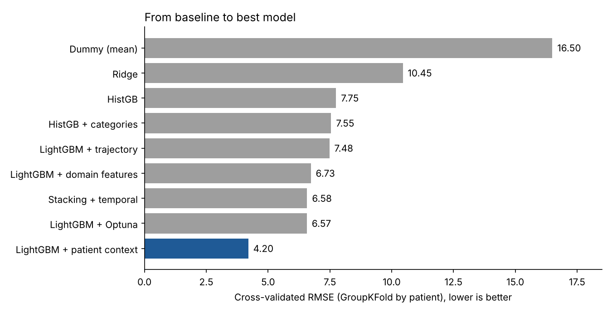
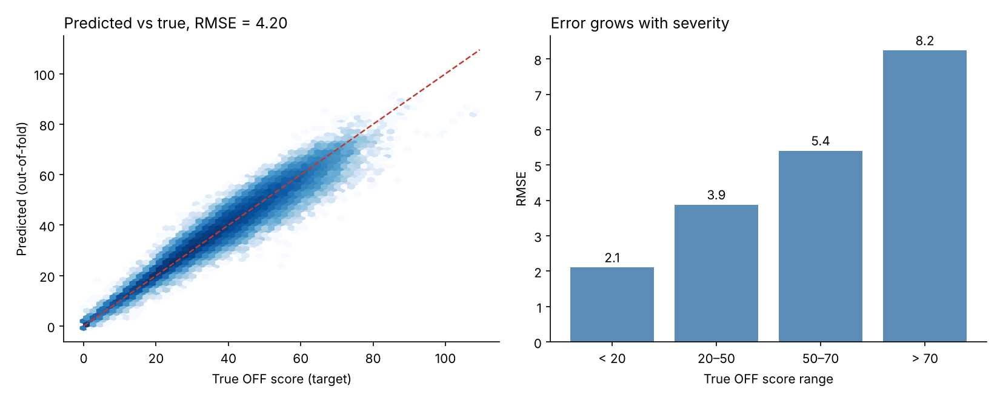

# Parkinson's Disease: Predicting the Unbiased OFF Motor Score

Machine learning project from the **Bobathon ESILV** hackathon, a Kaggle competition organised by Probabl and IBM.

**Goal:** for each patient visit, predict the *true* OFF MDS-UPDRS motor score, a debiased measure of disease severity, from noisy clinical records.

**Result:** RMSE **4.20 ± 0.06** with patient-grouped cross-validation, down from 16.5 for a mean baseline and 6.57 for the best model without patient-level features.



## Why this problem matters

The MDS-UPDRS motor score (0 to 132) measures motor severity in Parkinson's disease. The score measured in the **OFF** state, without the effect of medication, is the best clinical proxy for neurodegeneration, but in practice it is biased:

- OFF exams are uncomfortable, so they are often skipped: `off` is missing for **42%** of visits
- the score depends on the clinician who rates it
- levodopa blood levels vary with the time since the last dose

The competition provides a *true OFF* target in which these biases were removed. The task is to recover it from what clinicians actually record.

## Data

| | Train | Test |
|---|---|---|
| Visits | 44,590 | 11,013 |
| Patients | 5,576 | 1,395 |
| Patients in both sets | **0** | |

Each visit has demographics, genetics (`gene`), cohort, levodopa-equivalent daily dose (`ledd`), time since intake, the rater, and the measured `on` and `off` scores. The data are **synthetic** (no real patients) and are not included in this repository: see [`data/README.md`](data/README.md).

The test set contains **new patients only**, so every model is evaluated with `GroupKFold(n_splits=5)` on `patient_id`. A plain `KFold` lets visits of the same patient leak between folds and gives over-optimistic scores.

## Approach

13 experiments, each one keeping a single change so its effect can be measured (full log in [`journal/JOURNAL.md`](journal/JOURNAL.md)):

1. **Baselines:** dummy mean, Ridge, HistGradientBoosting
2. **Categorical variables and missingness:** native categorical support in gradient boosting; missing values kept as a signal rather than imputed blindly
3. **Domain features:** per-fold rater bias, missingness indicators, interactions, domain-based imputation
4. **Model choice and tuning:** LightGBM, XGBoost (GPU), stacking, Optuna
5. **Patient context (largest gain):** each visit is enriched with the patient's other visits (per-patient aggregates of `on`/`off`, interpolation of missing scores, lag/lead and rolling windows, slopes over time)

Ablation of the patient-context features (LightGBM, same folds):

| Features | CV RMSE |
|---|---|
| Base set (22 columns) | 6.56 |
| + per-patient aggregates and interpolation | 5.11 |
| + lag/lead and rolling windows | 4.36 |
| + slopes and trajectory (122 columns) | **4.20** |

## Results



- Predictions follow the diagonal closely, without systematic bias.
- Error is lowest for mild patients (RMSE 2.1 below 20) and grows with severity (8.2 above 70), where training data are scarce.
- Visits with a missing `off` score are harder (RMSE 4.86 vs 3.64 when `off` is present).
- The most important features are the rater, the patient's OFF and ON slopes over time, age at diagnosis and the patient's mean OFF score.

## Limitations

- **Future visits are used:** lead features and per-patient aggregates use the patient's later visits. This is allowed in the competition setting (all visits of a test patient are available), but a model used in real time could only rely on past visits. A causal-only variant is the next experiment to run.
- **Trajectory features differ between CV and test:** `patient_velocity_off` and `patient_accel_off` are computed for training patients only and set to 0 for test patients, so cross-validation may be slightly optimistic compared with the leaderboard.
- **`rater_bias`** is the per-rater mean target clipped to [-2, 2]. Since the target mean is about 37, the clip makes it nearly constant; centring it before clipping would make it useful.

## How to run

```bash
python -m venv .venv
source .venv/bin/activate        # Windows: .venv\Scripts\activate
pip install -r requirements.txt
pip install -e .

python data/eda.py                              # exploratory analysis
python experiments/13_patient_context.py        # best model
```

Put the competition CSVs in `data/` first. The experiment scripts log their reports to [Skore Hub](https://skore.probabl.ai), which needs an account and a `.skore` credentials file at the root of the repository (not committed).

## Repository structure

```text
.
├── data/              # EDA script and summary (CSV files not included)
├── experiments/       # one script per experiment, 01_dummy.py → 13_patient_context.py
├── figures/           # figures used in this README
├── journal/           # experiment log: decisions, scores, ablations
└── src/parkinson/     # shared helpers
```

## Tech stack

Python · pandas · scikit-learn · LightGBM · XGBoost · Optuna · skrub · skore

## Author

**Noé Payan, Joe Vaseekaran, Lisandru Zuccarelli**, engineering student in Data & Artificial Intelligence, ESILV (Paris)
